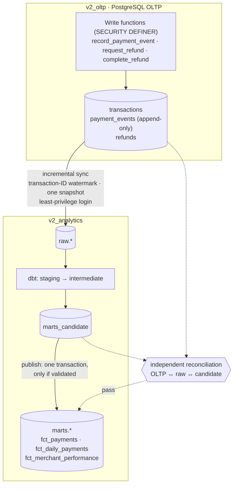
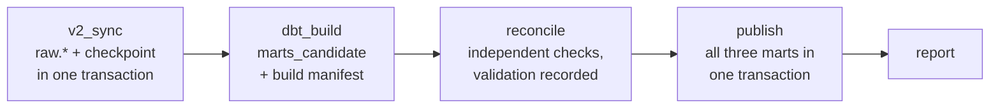

# Fintech Data Platform

A batch data pipeline for payments that is built around **financial correctness**: every published number is tested, reconciled back to the source, and published atomically, or not at all.

PostgreSQL (OLTP) → incremental Python sync → dbt (staging → intermediate → marts) → Airflow write-audit-publish. Everything runs locally in Docker.



Orchestrated by the Airflow DAG `payments_v2_pipeline`: **v2_sync → dbt_build → reconcile → publish → report**.

## Design decisions

| Problem | Decision |
|---|---|
| A timestamp watermark misses rows from long transactions that commit late | The sync uses a **transaction-ID watermark** over one `REPEATABLE READ` snapshot. Data and checkpoint commit in the same transaction. |
| A failed run must never leave consumers with half-updated numbers | **Write-audit-publish:** dbt builds into a candidate schema, the run reconciles OLTP ↔ raw ↔ candidate, and only then publishes to `marts` in one transaction. |
| Joining payments to refunds row by row double-counts payments | Payments and refunds are aggregated **separately**, then joined on day and currency. A dbt test asserts that the totals match staging. A naive join gives $270 instead of $170. |
| Money must stay exact and comparable | Integer minor units per currency. Currencies are never summed together. Refunds can never exceed the captured amount. |
| Bad event histories should be visible, not silently fixed | Payment state is derived from `event_sequence` only. Malformed histories are flagged, not repaired. |
| The pipeline should not need more access than it uses | The sync runs as a least-privilege login and refuses to continue when the source database identity changes. |

## Problems found and fixed

Each of these was found by reproducing it or by auditing the implementation, then fixed and covered by tests.

| Problem | How it was found | Fix |
|---|---|---|
| A timestamp cursor (`updated_at`, `received_at`) **silently loses rows** from transactions that commit late | Reproduced with real concurrent transactions; a concurrency fuzz test left **221 rows missing or stale**, against **0** for the transaction-ID watermark | Watermark on the snapshot's `xmin` (`xid8`), with newer versions applied in run order rather than by timestamp |
| A unique constraint added to support a refund-currency foreign key **broke concurrent payment creation** | The existing concurrency tests failed after the change | Dropped the constraint and enforced refund currency with a commit-time check, leaving the payment write function untouched |
| A failed `dbt build` could **publish partially rebuilt marts**: dbt tests that read several models cannot block their downstream models | Final architecture audit, confirmed in dbt-core's test-blocking logic | Write-audit-publish: build a candidate schema, reconcile it, publish all three marts in one transaction bound to the same pipeline run |
| Reconciliation compared **grand totals only**, so revenue put on the wrong day or merchant would pass | Final architecture audit | An independent Python recomputation of every mart row and field; negative tests corrupt dates, merchants and rates while keeping totals correct |
| Migrated MVP history carried **synthetic timestamps** that looked like real processor times | Final architecture audit | Explicit provenance columns and estimate flags through OLTP, sync, raw and marts; nothing rewritten |

## Quality and evidence

- **84 dbt data tests and 7 dbt unit tests** run in every build.
- **313 pytest tests** run against disposable databases.
- **End-to-end acceptance through Airflow** covers scenarios A–F, including injected sync, dbt and reconciliation failures, late-committing writers, and recovery. The latest run shows 112 checks passing and none failing (see [`docs/evidence/`](docs/evidence/README.md) for which log to read).
- Full design, proofs and runbooks: [`docs/v2/PHASE1_DESIGN.md`](docs/v2/PHASE1_DESIGN.md). Three-minute walkthrough: [`docs/DEMO.md`](docs/DEMO.md).

## Quick start

```bash
docker compose up -d
```
```bash
./scripts/v2/reset_v2.sh
```
```bash
./scripts/v2/trigger_v2_dag.sh
```

The Airflow UI is at http://127.0.0.1:8080. Credentials go in `.env`; copy `.env.example` to create it.

| Component | Version | Where |
|---|---|---|
| PostgreSQL | 16 (alpine) | `127.0.0.1:5434`, container `fintech-postgres` |
| Airflow | 3.3.2, LocalExecutor | UI at `http://127.0.0.1:8080` |
| dbt | dbt-core 1.12.5 + dbt-postgres 1.11.0 | `dbt/v2` (V2), `dbt/` (MVP), runs inside the Airflow image |
| Python sync | psycopg 3 | `sync/v2_sync.py` (V2), `sync/incremental_sync.py` (MVP) |

---

The sections below are the detailed reference: V2 internals, the original MVP, and the operator runbooks.


## V2: payment lifecycle, reliable sync, analytics and orchestration

V2 rebuilds the pipeline around financial correctness. It runs only in its own databases (`v2_oltp`, `v2_analytics`); the MVP below is unchanged. Full design, proofs and runbooks: [`docs/v2/PHASE1_DESIGN.md`](docs/v2/PHASE1_DESIGN.md).



If any step fails, the later steps don't run, and the published `marts.*` stay exactly as the last successful run left them.

- **OLTP rules:**
  - integer minor units per currency;
  - the payment lifecycle `created → authorized → captured`, plus `created/authorized → failed`;
  - contiguous, idempotent event sequences;
  - partial refunds that can never exceed the captured amount;
  - writes only through `SECURITY DEFINER` functions.
- **Sync:** a transaction-ID watermark (`sync_xid`) over one `REPEATABLE READ` snapshot. Data and checkpoint commit together. Payment events are insert-only, and a conflicting re-read fails the run. It runs as a least-privilege login, and blocks if the source identity changes.
- **dbt** (`dbt/v2`, profile `fintech_v2`, target `v2`):
  - it derives payment state from `event_sequence` only, and flags malformed histories rather than repairing them;
  - refunded volume counts **succeeded** refunds on their `succeeded_at` date;
  - currencies are never added together;
  - 84 data tests and 7 unit tests run in every build.
- **Airflow `payments_v2_pipeline`:** write → audit → publish. Sync → dbt build (`marts_candidate`) → reconciliation (OLTP ↔ raw ↔ candidate, recorded) → **publish** (one transaction into `marts`, only for the same validated run) → report. A failed sync, dbt build or reconciliation never changes the published marts. It's manual by default, runs one at a time, and a failed run is safe to re-trigger.
- **Consumers** read `marts.*`. Use one REPEATABLE READ transaction when several queries must agree; `marts.current_publication` says which publication you see.

### Run V2 locally
```bash
docker compose up -d
```
```bash
./scripts/v2/reset_v2.sh
```
That rebuilds `v2_oltp` / `v2_analytics` from the seed, applies all migrations and provisions the sync login.

```bash
./scripts/v2/trigger_v2_dag.sh
```
That runs the full pipeline through Airflow. `sync`, `dbt` or `reconcile` as an argument injects a failure at that step.

```bash
./scripts/v2/run_acceptance_v2.sh
```
That's the end-to-end acceptance (Scenarios A–F) through Airflow, writing `docs/evidence/acceptance_v2_*.log`.

```bash
.venv/bin/python -m pytest
```
That's the V2 test suite (disposable `v2_test_*` databases; needs Postgres running).

The pieces individually: `python -m sync.v2_sync` (least-privilege login from `.env`), `cd dbt/v2 && dbt build --profiles-dir ..`, `python -m sync.v2_reconcile`, `python -m sync.v2_report`. The UI is at `http://127.0.0.1:8080`. For an optional schedule, set `V2_PIPELINE_SCHEDULE` (e.g. `@hourly`) in `.env` and restart the Airflow services.

### V2 metrics, in short
Everything is per currency, in minor units. Exact definitions are in the design doc (Step 7).
- **Captured volume:** by capture date.
- **Success rate:** captured / (captured + failed), with in-flight payments excluded. Two clearly labelled bases: *cohort* (by creation date) and *outcome* (by capture or failure date).
- **Refunded volume:** succeeded refunds by `succeeded_at`.
- **Net captured:** captured − refunded, on event dates.

For the MVP demo both bases give $150 / 66.67% / $30, then $170 / 75% / $30.

### V2 limitations
- **Not log-based CDC:** the sync replicates the latest state only. No hard deletes, and no intermediate versions of mutable rows; payment history survives through `payment_events`.
- **Restores:** source restores require the generation-rotation and reinitialization runbook.
- **Synthetic backfill:** migrated MVP payments and refunds carry synthetic, upper-bound lifecycle timestamps (authorization, capture, failure, refund completion) and a synthetic `legacy_unknown` failure code. They're labelled explicitly (event `source`, `refunds.record_source`, the `*_is_estimate` and provenance columns, and the marts' estimate counts); nothing is rewritten.
- **Rebuilds and currency:** marts are rebuilt in full on every run, with no FX conversion.
- **Local security:** dbt, reconciliation and publish run as the database owner. Every Airflow task can read the owner's credentials (`env_file: .env` and the mounted project folder): the sync's least privilege is enforced by code, not by isolation. The local Docker Postgres trusts in-container connections. See "Local security limitations" in the design doc.

## MVP

Everything below describes the original MVP (unchanged).

## Databases

One Postgres instance holds isolated databases:

| Database | Purpose |
|---|---|
| `fintech_oltp`, `fintech_analytics` | The original step-1 data. The demo never touches them. |
| `demo_oltp`, `demo_analytics` | Demo environment. Dropped and recreated by `scripts/reset_demo.sh`. |
| `airflow` | Airflow metadata. |

Both demo databases use the same DDL as the original ones (`docker/postgres/init/schema/`).

## Demo data

The demo uses four USD payments and two refunds, all on **2026-10-15 UTC**:

| Payment | Amount | Status | Refunds |
|---|---|---|---|
| 3001 | $100 | succeeded | $10 succeeded, $20 succeeded |
| 3002 | $50 | succeeded | |
| 3003 | $30 | failed | |
| 3004 | $20 | pending, later set to succeeded | |

## Metric definitions (`marts.fct_daily_payments`)

The table has one row per UTC day and currency. Its primary key is `summary_id = "<date>|<currency>"`.

- **success_amount:** sum of succeeded payments, counted on the UTC day the payment was created.
- **success_rate_pct:** succeeded / (succeeded + failed). Pending payments are not yet decided, so they are excluded from both the numerator and the denominator.
- **refund_amount:** sum of succeeded refunds, counted on the UTC day the refund was created.
- Payments and refunds are aggregated **separately**, then joined on day and currency. A row-level payment-to-refund join would count the $100 payment once per refund. The acceptance log shows the wrong result such a join gives: $270 instead of $170.

| State | success_amount | success_rate_pct | refund_amount |
|---|---|---|---|
| Initial | 150.00 | 66.67 | 30.00 |
| After 3004 becomes succeeded | 170.00 | 75.00 | 30.00 |

## Run it

All commands run from the project root. Credentials and Airflow secrets live in `.env`; copy `.env.example` and fill it in for a fresh checkout.

```bash
docker compose up -d --wait            # Postgres + Airflow (first run builds the image, ~3 min)
./scripts/reset_demo.sh                # (re)create demo_oltp / demo_analytics with the seed data
./scripts/trigger_dag.sh               # trigger the DAG, wait, print task states
./scripts/check_demo.sh                # row counts, the $20 payment, checkpoints, daily summary
```

Failure injection and recovery:

```bash
docker compose exec -T postgres sh -c 'psql -U "$POSTGRES_USER" -d demo_oltp -c "UPDATE transactions SET status = '\''succeeded'\'' WHERE transaction_id = 3004"'
./scripts/trigger_dag.sh transactions  # sync raises just before committing transactions → run fails
./scripts/check_demo.sh                # 3004 still pending in raw, checkpoint unchanged, metrics unchanged
./scripts/trigger_dag.sh               # recovery run
./scripts/check_demo.sh                # 170.00 / 75.00 / 30.00, still 4 transactions
```

Full acceptance run. It resets the demo, performs all of the steps above through Airflow, asserts every expected value, and writes the log to `docs/evidence/`:

```bash
./scripts/run_acceptance.sh
```

Airflow UI: <http://127.0.0.1:8080>. Log in with `AIRFLOW_ADMIN_USER` / `AIRFLOW_ADMIN_PASSWORD` from `.env`. Open the DAG **fintech_demo_pipeline**. To inject a failure from the UI, use *Trigger* with the config `{"fail_before_commit": "transactions"}`.

Other useful commands:

```bash
docker compose exec airflow-scheduler airflow dags list-runs fintech_demo_pipeline
docker compose exec airflow-scheduler bash -c 'cd /opt/project/dbt && /home/airflow/dbt-venv/bin/dbt test --profiles-dir . --target-path /tmp/dbt/target'
docker compose stop                     # stop everything, keep data
docker compose up -d --wait postgres    # Postgres only, without Airflow
```

## Safety guards

- `fintech_oltp` and `fintech_analytics` are protected (`tools/db_guard.py`).
- The sync refuses to write to `fintech_analytics` unless `FINTECH_ALLOW_PROTECTED_DB_WRITES=1` is set for that one command.
- V2 migrations accept only `v2_*` databases.
- `scripts/fingerprint_protected_dbs.sh` prints a read-only fingerprint of the protected databases, to compare before and after any work.
- V2 payment state changes only through `record_payment_event()` (migration `V005`), and refunds only through `request_refund()` / `complete_refund()` (migration `V006`).
- The V2 sync (`python -m sync.v2_sync`, `v2_oltp` → `v2_analytics`) uses a transaction-ID watermark rather than timestamps. It refuses to continue when the source identity changes (rebuild or restore) until an explicit `--reinitialize`. It runs as the least-privilege login `v2_sync_login` (read-only on `v2_oltp`, no deletes on `v2_analytics`), and refuses a superuser unless `--as-admin` is given for operator procedures. **After any restore of `v2_oltp`, rotating the source generation is mandatory**; see the runbook in `docs/v2/PHASE1_DESIGN.md` (Step 6 hardening). The application role `v2_payment_app` can read but cannot write payment tables directly. See `docs/v2/PHASE1_DESIGN.md`.

## How the sync works

- For each table, rows are read from the source in `(updated_at, pk)` order, strictly after the stored cursor `(last_updated_at, last_pk)`.
- Rows are upserted by primary key into `raw.<table>`. An older `updated_at` never overwrites a newer one.
- Each batch's upsert and its checkpoint update commit in **one transaction** in the analytics database. `--fail-before-commit <table>` raises after both statements have executed but before the commit, which demonstrates that they roll back together.
- A source trigger refreshes `updated_at` on every UPDATE. That is how the `pending → succeeded` change is picked up, while `created_at` keeps the metric on the original day.

## dbt tests (22, all part of `dbt build`)

- **Primary keys:** `unique` + `not_null` on every staging key and on `fct_daily_payments.summary_id`.
- **Relationships:** transactions → users and merchants; refunds → transactions.
- **Accepted values:** payment and refund status.
- **`assert_refund_amounts_valid`:**
  - every refund amount is positive;
  - succeeded refunds never exceed the payment amount;
  - succeeded refunds only exist on succeeded payments.
- **`assert_payments_not_double_counted`:** the daily summary equals payments and refunds summed straight from staging, with no join between them.

## Evidence

- `docs/evidence/acceptance_*.log` contains the full acceptance run (27 checks).
- `docs/evidence/negative_refund_test.log` shows the refund check failing on a deliberately bad refund, then passing again after cleanup.

## Known limitations

- **Hard deletes:** a row hard-deleted in the source is not propagated.
- **Late commits:** a long source transaction that commits after a sync, with an earlier `updated_at`, could be missed. A lookback window or CDC would close that gap.
- **Full rebuild:** `fct_daily_payments` is rebuilt as a full table on every run. That is fine at this size; an incremental model would be the next step.
- **Single superuser:** Airflow and dbt connect with the Postgres superuser from `.env`. This is acceptable for a local demo, not for shared environments.

## License

MIT, see [`LICENSE`](LICENSE).
